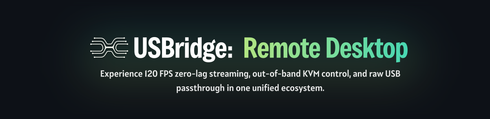
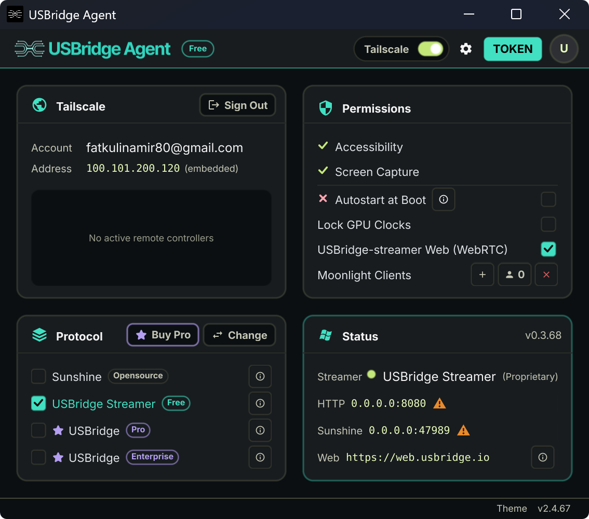

# USBridge Remote

  

[English](README.md) | [Deutsch](docs/README_DE.md) | [Français](docs/README_FR.md) | [Italiano](docs/README_IT.md) | [Español](docs/README_ES.md) | [Português (Brasil)](docs/README_PT_BR.md) | [Українська](docs/README_UA.md) | [Polski](docs/README_PL.md) | [日本語](docs/README_JA.md) | [한국어](docs/README_KO.md) | [简体中文](docs/README_ZH.md)

---

**USBridge Remote** is a low-latency **remote desktop** and **KVM-over-IP** ecosystem: one client for Windows, macOS, Linux, Android, iOS and the browser, a host agent with a built-in **Sunshine / Moonlight** game streamer, and IP-KVM firmware for **Radxa Zero 3W**, **Radxa Cubie A7Z** and **Sipeed NanoKVM** boards. It combines **hardware-level BIOS access** and **software remote desktop** in a single interface, with USB passthrough for gamepads, Wacom tablets, MIDI and microphones, and Tailscale P2P networking with no port forwarding.

  

## Download

**All-in-one installer (Client + Agent, pick either or both during setup):** [Windows Setup (.exe)](https://github.com/USBridge-Technologies/USBridge-Remote/releases/latest/download/USBridge-Windows-x86_64-Setup.exe) · [macOS disk image (.dmg)](https://github.com/USBridge-Technologies/USBridge-Remote/releases/latest/download/USBridge-macOS-arm64.dmg)

Linux packages (.deb, .rpm, Arch) add the USBridge package repository, so the apps update with the rest of the system. All files are on the [latest release](https://github.com/USBridge-Technologies/USBridge-Remote/releases/latest).

### Client
The Client is the control interface — installed on your workstation or laptop (or run directly in your browser). It manages connections, live remote desktop, virtual device passthrough, and snapshot registry.

| Platform | Installer | Portable | Packages / Store |
| :--- | :--- | :--- | :--- |
| **Windows** x86_64 | [Setup (.exe)](https://github.com/USBridge-Technologies/USBridge-Remote/releases/latest/download/USBridge-Windows-x86_64-Setup.exe) | [Portable (.zip)](https://github.com/USBridge-Technologies/USBridge-Remote/releases/latest/download/USBridgeClient-Windows-x86_64.zip) | — |
| **macOS** Apple Silicon | [Disk image (.dmg)](https://github.com/USBridge-Technologies/USBridge-Remote/releases/latest/download/USBridgeClient-macOS-arm64.dmg) | — | — |
| **Linux** x86_64 | [Debian / Ubuntu (.deb)](https://github.com/USBridge-Technologies/USBridge-Remote/releases/latest/download/USBridgeClient-Linux-x86_64.deb) | [AppImage](https://github.com/USBridge-Technologies/USBridge-Remote/releases/latest/download/USBridgeClient-Linux-x86_64.AppImage) | [Fedora / RHEL (.rpm)](https://github.com/USBridge-Technologies/USBridge-Remote/releases/latest/download/USBridgeClient-Linux-x86_64.rpm) · [Arch (.pkg.tar.zst)](https://github.com/USBridge-Technologies/USBridge-Remote/releases/latest/download/USBridgeClient-Linux-x86_64.pkg.tar.zst) |
| **Android** ARM64 | [APK (self-updating)](https://github.com/USBridge-Technologies/USBridge-Remote/releases/latest/download/USBridgeClient-Android-arm64-selfupdate.apk) | — | [Google Play](https://play.google.com/store/apps/details?id=io.usbridge.client) |
| **iOS / iPadOS** | — | — | [App Store](https://apps.apple.com/us/app/usbridge-client/id6787665935) |
| **Web browser** | — | [Open web.usbridge.io](https://web.usbridge.io) | — |

🌐 **Zero-Install Web Client**: No installation required. Just open [web.usbridge.io](https://web.usbridge.io) to connect instantly. *(Note: The web client operates with some feature and performance limitations due to browser security sandbox and WebRTC constraints. For the full uncompromised experience, use the native apps).* The web client reaches an Agent through its trusted `<label>.device.usbridge.io` name: the Agent gets that certificate the first time a browser comes to it, and only while you're signed in to your USBridge account in the Agent — so the very first attempt can take a few minutes. See the Agent's **Status → Certificate** row, or the [Agent docs](agent/docs/README.md#platform-notes-from-the-top-level-readme) for details. A USBridge KVM also serves the web client itself at `https://<kvm>:9443/` and moves to its own trusted name when it can.

## Agent

The Agent runs on the target machine — the server or PC you want to access remotely. It captures the screen and sound, passes your keyboard, mouse and gamepad through to that machine, and connects it over Tailscale.

<table>
  <tr>
    <!-- Left Column: Downloads Table -->
    <td valign="middle">
      <table>
        <tr>
          <th>Platform</th>
          <th>Downloads</th>
        </tr>
        <tr>
          <td><b>Windows</b> x86_64</td>
          <td><a href="https://github.com/USBridge-Technologies/USBridge-Remote/releases/latest/download/USBridgeAgent-Windows-x86_64-Setup.exe">Setup (.exe)</a> <a href="https://github.com/USBridge-Technologies/USBridge-Remote/releases/latest/download/USBridgeAgent-Windows-x86_64.zip">Portable (.zip)</a></td>
        </tr>
        <tr>
          <td><b>macOS</b> Apple Silicon</td>
          <td><a href="https://github.com/USBridge-Technologies/USBridge-Remote/releases/latest/download/USBridgeAgent-macOS-arm64.dmg">Disk image (.dmg)</a></td>
        </tr>
        <tr>
          <td><b>Linux</b> x86_64</td>
          <td><a href="https://github.com/USBridge-Technologies/USBridge-Remote/releases/latest/download/USBridgeAgent-Linux-x86_64.deb">Debian / Ubuntu (.deb)</a> <a href="https://github.com/USBridge-Technologies/USBridge-Remote/releases/latest/download/USBridgeAgent-Linux-x86_64.rpm">Fedora / RHEL (.rpm)</a> <a href="https://github.com/USBridge-Technologies/USBridge-Remote/releases/latest/download/USBridgeAgent-Linux-x86_64.pkg.tar.zst">Arch (.pkg.tar.zst)</a> <a href="https://github.com/USBridge-Technologies/USBridge-Remote/releases/latest/download/USBridgeAgent-Linux-x86_64.AppImage">AppImage (portable)</a></td>
        </tr>
      </table>
    </td>
    <!-- Right Column: Image -->
    <td valign="middle" width="450">
      
    </td>
  </tr>
</table>

## Features

**Hardware-accelerated encoding:** NVIDIA **NVENC** · AMD **AMF** · Intel **QSV** · Linux **VAAPI** · plus software **H.264 (OpenH264)** for VMs and machines without a GPU encoder

<table>
  <tr>
    <td width="33%" valign="top">
      <code>BASIC FUNCTIONALITY</code>  
      <b>SUNSHINE OPEN-SOURCE</b> 
      <i>Standard Game Streaming</i>  
      ✓ Built-in open-source Sunshine streamer 
      ✓ <a href="https://www.usbridge.io/sunshine-vs-apollo/">Alternative streamers</a>: Vibepollo (Sunshine fork with Apollo built in, Windows) and punktfunk (Moonlight-compatible, Windows & Linux), switch in one click 
      ✓ Built-in benchmark to compare Sunshine, RustShine, Vibepollo and punktfunk on your own hardware and network 
      ✓ Low-latency desktop & gaming access 
      ✓ Bi-directional file & text clipboard     
      ✓ Multi-monitor display switching 
      ✓ Integrated Tailscale P2P networking 
      ✓ Guest access: invite people by e-mail with a role and an end date 
      ✓ Native Wayland support (promptless capture)
    </td>
    <td width="33%" valign="top">
      <code>+ BASIC FEATURES</code>  
      <b>USBRIDGE FREE</b> 
      <i>Rust based Stream Engine</i>  
      ✓ Instant-connect custom remote protocol 
      ✓ Raw <a href="https://www.usbridge.io/usb-passthrough/">USB peripheral device passthrough</a> 
      ✓ Adaptive streaming optimized for Wi-Fi stability 
      ✓ HDR10 
      ✓ Lossless 4:4:4 chroma color accuracy 
      ✓ Microphone passthrough (client → host) 
      ✓ MIDI device passthrough (client → host) 
      ✓ GPU encoding: NVENC, AMF, QSV, VAAPI 
      ✓ Software H.264 (OpenH264) for VMs without a GPU 
      ✓ <a href="https://www.usbridge.io/pyrowave/">PyroWave</a> low-latency wavelet codec (by Valve) 
      ✓ Headless virtual display management 
      ✓ Low-latency gamepad controller passthrough 
      ✓ Web browser client access (no installation required) 
      ✓ Windows pre-login access (secure credential entry)
    </td>
    <td width="33%" valign="top">
      <code>+ BASIC FEATURES</code> <code>+ FREE FEATURES</code>  
      <b>USBRIDGE PRO</b> 
      <i>Professional Workflows</i>  
      ✓ Wacom tablet support with pressure & tilt (<a href="https://www.usbridge.io/macos-wacom-support/">macOS too</a>) 
      ✓ <a href="https://www.usbridge.io/hardware-agent/">Hardware KVM firmware</a> for Radxa Zero 3W, Radxa Cubie A7Z and Sipeed NanoKVM: BIOS/UEFI access, ISO virtual media, Btrfs snapshots ($19 lifetime per device, 24 h free evaluation) 
      ✓ <a href="https://www.usbridge.io/moonlight-hardware-streamer/">Hardware Moonlight streamer</a> on those boards: any HDMI source (PC, PS5, Xbox, Switch) to Moonlight at 1080p 60 FPS, no software on the source  
    </td>
  </tr>
</table>

## Quick Start

1. **Install the Agent** on the machine you want to access remotely. Launch it — it will display a connection token and Tailscale address. Connect Tailscale if you need access over the internet.

2. **Install the Client** on your workstation, laptop, or phone.

3. **Add a connection** — enter the IP or Tailscale address shown in the Agent window. That's it.

  

## Hardware Integration

<table>
  <tr>
   <td width="33%" valign="top">
      <b>Hardware-Level BIOS Control</b> 
      USBridge Remote integrates natively with the USBridge-KVM 2.0 appliance for out-of-band, bare-metal management before OS boot. It is also the first hardware Moonlight streamer: the stock Moonlight client pairs with the KVM and streams any HDMI source (a PC or a game console) with no software on it.  
      
    </td>
    <td width="33%" valign="top">
      <b>DIY IP-KVM Firmware</b> 
      Flash the official firmware on a compatible board (Radxa Zero 3W, Radxa Cubie A7Z) with an HDMI-to-USB capture dongle to build your own IP-KVM. On a <b>Sipeed NanoKVM</b> it replaces the stock firmware: smooth 60 FPS instead of a stuttering picture, audio and microphone, gamepads, USB passthrough and Moonlight support (<a href="https://www.usbridge.io/hardware-agent/">download the firmware</a>).  
      
    </td>
    <td width="33%" valign="top">
      <b>USB/IP Hardware Dongle (ESP32-S3)</b> 
      Software USB passthrough hits a wall on macOS: there is no VHCI driver to attach to, so a remote Wacom tablet (or other USB device) can't be presented as real hardware. This dongle plugs into the Mac and does in hardware what <code>vhci-hcd</code> does in software elsewhere — the exported device enumerates with its own VID/PID, bound by macOS's own driver.  
      
    </td>
  </tr>
</table>

### NanoKVM with USBridge firmware: 60 FPS instead of lag

  
    
  
  
  
  

A 2-minute video: a Sipeed NanoKVM with heavy lag in a home lab becomes a 60 FPS KVM over IP with almost no input lag after flashing USBridge firmware, fast enough to play games with a gamepad. Tailscale works on the board itself, so it is reachable from anywhere with no port forwarding; sound plays both ways, and FEC (forward error correction) rebuilds lost packets, so the picture stays clean on Wi-Fi and over the internet. Firmware for the NanoKVM, Radxa Zero 3W and Radxa Cubie A7Z is on the [Hardware Agent page](https://www.usbridge.io/hardware-agent/).

## FAQ

<b>Does USBridge work with Moonlight and Sunshine?</b>

Yes. The Agent ships the open-source Sunshine streamer, so the stock Moonlight client connects to it. Vibepollo (a Sunshine fork with Apollo built in) and punktfunk are built in too and switch in one click.

<b>Is there a hardware Moonlight streamer?</b>

Yes. A USBridge KVM 2.0, or a Radxa Zero 3W, Radxa Cubie A7Z or Sipeed NanoKVM flashed with USBridge firmware, is a Sunshine-compatible GameStream host for whatever is on its HDMI input: a PC, PS5, Xbox or Switch. It streams 1080p 60 FPS with audio to the stock Moonlight client, with no software on the source. See [Hardware Moonlight Streamer](https://www.usbridge.io/moonlight-hardware-streamer/).

<b>Which streamer is fastest on my PC?</b>

It depends on the GPU, the driver and the network. The built-in benchmark runs Sunshine, RustShine, Vibepollo and punktfunk on your own hardware and network and compares them. See [Sunshine vs Apollo vs Vibepollo vs Punktfunk](https://www.usbridge.io/sunshine-vs-apollo/).

<b>Which GPUs are supported for encoding?</b>

NVIDIA NVENC, AMD AMF, Intel QSV and VAAPI on Linux. Virtual machines and PCs without a GPU encoder use software H.264 (OpenH264).

<b>What is free and what needs Pro?</b>

4:4:4 color, HDR10, PyroWave, gamepads, microphone, MIDI and raw USB passthrough are free. Wacom tablets with pressure and tilt, and the hardware KVM firmware ($19 lifetime per device, 24 h free evaluation), are Pro.

<b>Can I turn a Sipeed NanoKVM or a Radxa board into an IP-KVM?</b>

Yes. Flash the USBridge firmware from the [Hardware Agent page](https://www.usbridge.io/hardware-agent/). You get BIOS/UEFI access, ISO and IMG virtual media, immutable Btrfs snapshots, 60 FPS video, audio and USB passthrough. Radxa boards need an HDMI-to-USB capture dongle.

<b>Do I need port forwarding?</b>

No. Connections go over Tailscale peer-to-peer, with automatic NAT traversal.

<b>Can I share access to a computer with someone else?</b>

Yes. Invite people by e-mail with a role and an end date; guests join through USBridge and need no Tailscale account.

## Resources & License

<table>
  <tr>
    <td width="33%" valign="top">
      <b>Development & Roadmap</b> 
      I maintain a public dashboard to track all planned features, architectural updates, and release schedules.  
      <a href="https://github.com/orgs/USBridge-Technologies/projects/3">View Live Roadmap</a>
    </td>
    <td width="33%" valign="top">
      <b>Project Links</b> 
      <ul>
        <li><a href="https://usbridge.io">Official Website</a></li>
        <li><a href="https://discord.com/invite/xqQ6ybkfWS">Discord (Beta Testing & Bugs)</a></li>
        <li><a href="https://www.reddit.com/r/USBridge/">Reddit</a></li>
        <li><a href="https://www.youtube.com/@KVMUSBridge">YouTube</a></li>
        <li><a href="https://www.patreon.com/USBridge_Technologies">Patreon Support</a></li>
      </ul>
    </td>
    <td width="33%" valign="top">
      <b>License (GPLv3)</b> 
      This project is licensed under the <b>GPLv3</b>. The multi-platform client incorporates codebase from <code>moonlight-common-c</code> (also GPLv3).  
      <a href="LICENSE">View LICENSE File</a>
    </td>
  </tr>
</table>

